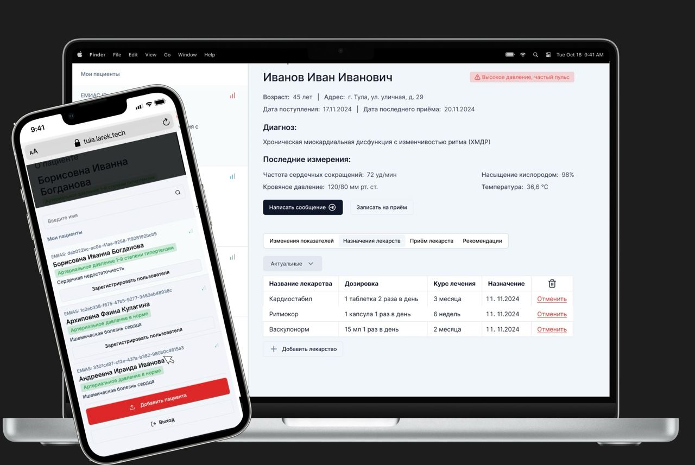

# AI Health Monitor: Dinosaurs Team

## Краткое описание проекта

Проект разработан командой «Динозаврики MISIS» в рамках хакатона "TulaDays". Цель проекта – создание инновационной системы для дистанционного мониторинга здоровья пациентов с помощью AI, автоматизации анализа показателей и удобной связи с врачами.

**Ключевой функционал:**

- Обработка медицинских показаний врачом (данные измерений, рекомендации, лекарства).
- Детекция показаний с тонометров и других приборов с использованием моделей компьютерного зрения.
- Удобный бот для взаимодействия пациентов и врачей.
- Напоминания о приеме лекарств, анализах и визитах.

## Установка и запуск проекта

### Клонирование репозитория:

```bash
git clone https://github.com/EgorTarasov/tuladays-2024.git
cd tuladays-2024
```

### Запуск проекта:

```bash
docker compose up --build -d
```

Для корректной работы обработки изображений необходимо настроить модели YOLOv5 и Tesseract OCR.

## Основной функционал проекта

- **Автоматическое обнаружение** показателей здоровья (с приборов, таких как тонометры).
- **Удобный интерфейс** для пациентов и врачей.
- **Анализ и предсказание** медицинских проблем с рекомендациями.

## Технологии и инструменты

- **Python 3.9**
- **YOLOv5**: детекция объектов.
- **Tesseract OCR**: распознавание текста.
- **Flask**: веб-интерфейс.
- **LLama-api**: LLM

## Команда проекта

- **Лиза Тарасова**: Product, Design
- **Егор Тарасов**: Backend
- **Данило Малбашич**: ML
- **Кирилл Киреев**: Frontend
- **Дима Пунов**: Backend

## Архитектура проекта

```plaintext
.
├── .gitignore
├── README.md
├── backend
│   ├── Dockerfile.backend
│   ├── Dockerfile.migration
│   ├── Makefile
│   ├── auth
│   │   ├── config.go
│   │   ├── constants.go
│   │   ├── errors.go
│   │   ├── handlers
│   │   │   ├── auth.go
│   │   │   ├── email.go
│   │   │   └── external.go
│   │   ├── middleware
│   │   │   └── middleware.go
│   │   ├── models
│   │   │   └── email.go
│   │   ├── repo
│   │   │   ├── pg.go
│   │   │   └── repo.go
│   │   └── service
│   │       ├── email.go
│   │       ├── external.go
│   │       ├── service.go
│   │       └── token.go
│   ├── chat
│   │   ├── config.go
│   │   ├── errors.go
│   │   ├── handlers
│   │   │   └── websocket.go
│   │   ├── models
│   │   │   ├── chat.go
│   │   │   └── message.go
│   │   ├── repo
│   │   │   ├── pg.go
│   │   │   └── repo.go
│   │   └── service
│   │       └── service.go
│   ├── cmd
│   │   └── main.go
│   ├── config.yaml
│   ├── dashboard
│   │   ├── config.go
│   │   ├── errors.go
│   │   ├── handlers
│   │   │   ├── dashboard.go
│   │   │   ├── medicine.go
│   │   │   └── user.go
│   │   ├── models
│   │   │   ├── medicine.go
│   │   │   └── patient.go
│   │   ├── repo
│   │   │   ├── ch.go
│   │   │   ├── pg.go
│   │   │   ├── pg_medicine.go
│   │   │   └── repo.go
│   │   └── service
│   │       └── service.go
│   ├── data
│   │   ├── click
│   │   │   └── migrations
│   │   │       └── 20241115165211_initial.sql
│   │   └── sql
│   │       ├── migrations
│   │       │   ├── 20241106082019_initial.sql
│   │       │   ├── 20241114183025_chat.sql
│   │       │   ├── 20241115163156_health_data.sql
│   │       │   ├── 20241116094221_doctors.sql
│   │       │   └── 20241116183232_medicine.sql
│   │       └── queries
│   │           ├── chat.sql
│   │           ├── medicine.sql
│   │           ├── patients.sql
│   │           └── users.sql
│   ├── go.mod
│   ├── go.sum
│   ├── pkg
│   │   ├── click
│   │   │   ├── click.go
│   │   │   └── config.go
│   │   ├── db
│   │   │   ├── chat.sql.go
│   │   │   ├── db.go
│   │   │   ├── medicine.sql.go
│   │   │   ├── models.go
│   │   │   ├── patients.sql.go
│   │   │   └── users.sql.go
│   │   └── postgres
│   │       ├── config.go
│   │       └── postgres.go
│   ├── server
│   │   ├── config.go
│   │   └── server.go
│   ├── sqlc.yaml
│   └── static
│       ├── index.html
│       ├── manifest.webmanifest
│       ├── sw.js
│       ├── vite.svg
│       └── workbox-3e8df8c8.js
├── bot
│   ├── .gitignore
│   ├── Dockerfile.telegram
│   ├── __pycache__
│   │   └── main.cpython-312.pyc
│   ├── ch.py
│   ├── db.py
│   ├── main.py
│   ├── ml.py
│   ├── models.py
│   ├── photos
│   │   └── .gitkeep
│   ├── poetry.lock
│   └── pyproject.toml
├── bot.larek.tech
├── build_and_push.sh
├── docker-compose.yaml
├── docker-config.yaml
├── docker_files
│   └── grafana.Dockerfile
├── docs
│   └── design.png
├── etl
│   ├── disease
│   │   ├── .gitignore
│   │   ├── parse.ipynb
│   │   ├── test.txt
│   │   └── vector.ipynb
│   └── external-data
│       └── generate.py
├── example.env
├── frontend
│   ├── .env.example
│   ├── .eslintrc.cjs
│   ├── .gitignore
│   ├── README.md
│   ├── components.json
│   ├── index.html
│   ├── package.json
│   ├── pnpm-lock.yaml
│   ├── postcss.config.js
│   ├── public
│   │   └── vite.svg
│   ├── src
│   │   ├── api
│   │   │   ├── endpoints
│   │   │   │   ├── auth.endpoint.ts
│   │   │   │   ├── drug.endpoint.ts
│   │   │   │   └── patient.endpoint.ts
│   │   │   ├── models
│   │   │   │   ├── auth.model.ts
│   │   │   │   ├── drug.model.ts
│   │   │   │   ├── patient.model.ts
│   │   │   │   └── user.dto.ts
│   │   │   └── utils
│   │   │       ├── api.ts
│   │   │       ├── auth-token.ts
│   │   │       ├── build-search.ts
│   │   │       └── index.ts
│   │   ├── app
│   │   │   ├── globals.css
│   │   │   └── index.tsx
│   │   ├── components
│   │   │   ├── cards
│   │   │   │   ├── patient.card.tsx
│   │   │   │   └── priority-icon.tsx
│   │   │   ├── forms
│   │   │   │   └── drug.form.tsx
│   │   │   ├── ui
│   │   │   │   ├── accordion.tsx
│   │   │   │   ├── alert.tsx
│   │   │   │   ├── avatar.tsx
│   │   │   │   ├── badge.tsx
│   │   │   │   ├── button.tsx
│   │   │   │   ├── calendar.tsx
│   │   │   │   ├── card.tsx
│   │   │   │   ├── chart.tsx
│   │   │   │   ├── command.tsx
│   │   │   │   ├── data-table.tsx
│   │   │   │   ├── dialog-form.tsx
│   │   │   │   ├── dialog.tsx
│   │   │   │   ├── drawer.tsx
│   │   │   │   ├── dropdown-menu.tsx
│   │   │   │   ├── empty.tsx
│   │   │   │   ├── form.tsx
│   │   │   │   ├── hint.tsx
│   │   │   │   ├── input.tsx
│   │   │   │   ├── label.tsx
│   │   │   │   ├── pagination.tsx
│   │   │   │   ├── popover.tsx
│   │   │   │   ├── radio-group.tsx
│   │   │   │   ├── scroll-area.tsx
│   │   │   │   ├── select.tsx
│   │   │   │   ├── separator.tsx
│   │   │   │   ├── sheet.tsx
│   │   │   │   ├── skeleton.tsx
│   │   │   │   ├── switch.tsx
│   │   │   │   ├── table.tsx
│   │   │   │   ├── tabs.tsx
│   │   │   │   ├── textarea.tsx
│   │   │   │   └── tooltip.tsx
│   │   │   └── widgets
│   │   │       ├── chart.tsx
│   │   │       ├── dashboard.view.tsx
│   │   │       ├── drug-select.tsx
│   │   │       ├── modal
│   │   │       │   ├── confirmation.modal.tsx
│   │   │       │   ├── modal-presenter.tsx
│   │   │       │   ├── modal.context.ts
│   │   │       │   ├── patient-data.modal.tsx
│   │   │       │   ├── show.ts
│   │   │       │   └── types.ts
│   │   │       ├── patient.modal.tsx
│   │   │       └── sidebar.tsx
│   │   ├── routeTree.gen.ts
│   │   ├── routes
│   │   │   ├── __root.tsx
│   │   │   ├── _doctor
│   │   │   │   ├── index.tsx
│   │   │   │   └── patient
│   │   │   │       └── $id.tsx
│   │   │   ├── _doctor.tsx
│   │   │   ├── login.tsx
│   │   │   └── register.tsx
│   │   ├── stores
│   │   │   ├── auth.service.ts
│   │   │   ├── drugs.store.ts
│   │   │   └── patient.store.ts
│   │   ├── types
│   │   │   ├── auth.type.ts
│   │   │   └── priority.type.tsx
│   │   ├── utils
│   │   │   ├── cn.ts
│   │   │   ├── hooks
│   │   │   │   ├── use-action.tsx
│   │   │   │   ├── use-auto-resize-textarea.ts
│   │   │   │   └── use-invalidate.ts
│   │   │   ├── pluralize.ts
│   │   │   ├── routes
│   │   │   │   ├── check-grant.ts
│   │   │   │   └── valid-routes.ts
│   │   │   └── zod
│   │   │       └── zz.ts
│   │   └── vite-env.d.ts
│   ├── tailwind.config.js
│   ├── tsconfig.app.json
│   ├── tsconfig.json
│   ├── tsconfig.node.json
│   ├── tsr.config.json
│   └── vite.config.ts
├── fs
│   └── volumes
│       ├── clickhouse
│       │   ├── config.d
│       │   │   └── config.xml
│       │   └── user.d
│       │       └── users.xml
│       └── grafana
│           └── datasources
│               └── clickhouse.yaml
├── ml
│   ├── Readme.md
│   ├── cv_detection
│   │   ├── prediction_pipeline.py
│   │   └── yolo_training.py
│   └── metrics.png
├── schema.excalidraw
├── todo.md
├── tula.conf
└── volumes
    └── .gitignore
```

## Демонстрация работы

Мобильный и веб-интерфейсы для пациентов и врачей:



Интерфейс позволяет врачам контролировать динамику показателей здоровья пациентов, назначать лекарства и анализы, а также оперативно реагировать на изменения.
